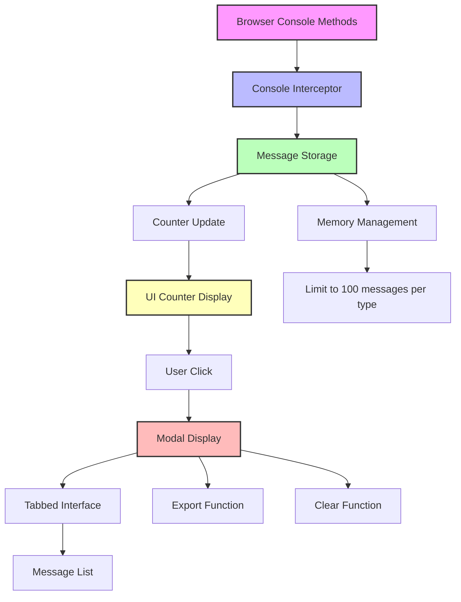
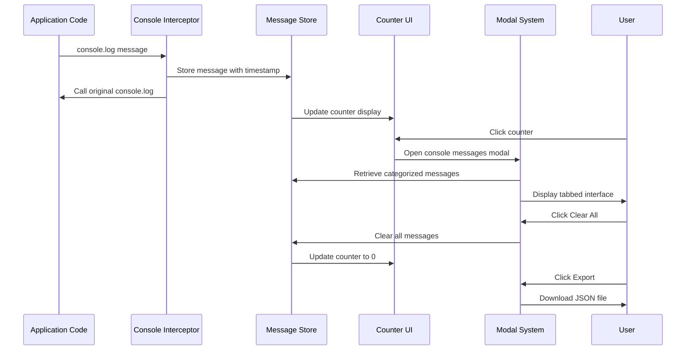

# Console Message Tracker Architecture

This document describes the architecture and implementation of the console message tracking system.

## Architecture Overview



## Component Flow



## Features

### Console Message Interception
- Intercepts all console methods: log, warn, error, info, debug
- Preserves original console functionality
- Stores messages with timestamps and type classification

### Memory Management
- Limits storage to 100 messages per type
- Automatically removes oldest messages when limit is reached
- Prevents memory leaks in long-running applications

### UI Components
- Floating Counter: Fixed position counter showing total messages
- Error/Warning Badges: Special indicators for errors and warnings
- Modal Interface: Tabbed display for categorized messages
- Export/Clear Actions: User controls for message management

### Integration
- Uses existing modal system from helpers.js
- Matches application dark theme styling
- Follows existing code patterns and conventions
- Compatible with existing event delegation system

## File Structure

```
public/
├── consoleTracker.js    # Main console tracking implementation
├── styles.css           # Updated with console tracker styles
├── index.html          # Updated to include console tracker script
├── app.js              # Existing application code
└── helpers.js          # Existing modal system
```

## Usage

The console tracker automatically initializes when the page loads and begins intercepting console messages immediately. Users can:

1. View the message count in the floating counter
2. Click the counter to open the messages modal
3. Browse messages by type using tabs
4. Clear all messages or export them as JSON
5. Continue using console methods normally

## API

The tracker exposes a global API via window.consoleTracker:

- Get all stored messages: window.consoleTracker.getMessages()
- Get message counts by type: window.consoleTracker.getCounts()
- Clear all messages: window.consoleTracker.clear()
- Export messages: window.consoleTracker.export()
